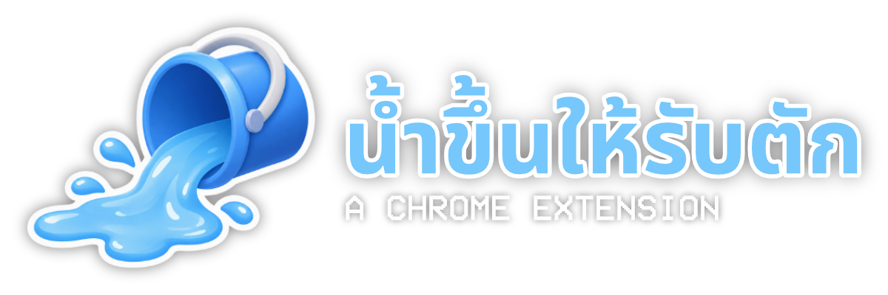

<div align="center">

<picture>
  
</picture>

**A Chrome extension that makes you think twice before every AI prompt.**
</br>This project is a part of [Stupid Hackathon in Thailand X](https://stupid.hackathon.in.th/x)

[Chrome Web Store](https://example.com/)
 | 
[Watch Demo](https://example.com/)
 | 
[Presentation Slide](https://drawdy.io/share/e0310af49708#key=yYuh6w4wck61dqPuKoxNrRCt9zKTbqB2nZwdYJL4awg)


</br>


</div>

They say every AI prompt drinks a little water somewhere in a data center. You never see it, so you never care. **Now you will.**

Every prompt you send to your favorite LLM (Claude, ChatGPT or Gemini) floods **your screen**, on every tab you have open, Smarter models will flood even faster. 
</br>
Your music will sound like it's playing from the bottom of a swimming pool. And your keyboard is soaked then the chat box stops working. Eventually, you can't click anything at all, and an alarm goes off until you deal with it.

# Contents

- [Features](#features)
- [Installation](#installation)
- [Supported Sites](#supported-sites)
- [Troubleshooting](#troubleshooting)
- [Known Limitations](#known-limitations)
- [Credits](#credits)
- [License](#license)

# Features

Everything that happens to your screen after you ask an AI to write that one email for you :

| Feature | Description |
|---|---|
| 🤖 Prompt Detection | On [supported sites](#supported-sites), pressing Enter in the chat box or clicking the send button adds water to your screen. The longer the prompt, the more water. Keep prompting and it rises until your screen is full. |
| 🌊 Water Physics | The water has its own physics. It sloshes, makes waves and tilts with your screen, just like real water! |
| 💧 Multiplier | Smarter models and higher effort settings multiply how much water each prompt adds. The better the model, the faster your screen floods. |
| 🔇 Muffled Audio | From **45%**, page audio and videos sound more and more muffled, like you're listening from underwater. |
| 🔒 Lockouts | From **80%**, the chat box on [supported sites](#supported-sites) is locked. Your keyboard is soaked, so it greys out and ignores clicks and typing. At **100%**, you can't click anything on the page at all. |
| 🪣 Drains | Get the water out from the extension's toolbar popup: 📷 tilt your laptop so the water pours off the edge (the webcam watches), 🎮 scoop it out with a Nintendo Joy-Con, or 📱 scoop it out with your phone. |

# Installation

### Chrome Web Store

- You can download the latest release from [Chrome Web Store](https://example.com/) page

### From a release (.zip)

<!-- TODO: link to the Releases page once the first release is published. -->

1. Download the latest `shitx-flood-extension-<version>.zip` from the [Releases](https://github.com/qwrtsdev/SHiT10-NamKhunHaiReepTak/releases) page.
2. Unzip it into a folder you will keep. The browser loads the extension from that folder every time it starts, so don't delete it.
3. Open `chrome://extensions` (Edge: `edge://extensions`, Brave: `brave://extensions`).
4. Turn on **Developer mode** (on top-right).
5. Click **Load unpacked** and select the unzipped folder.

### From source

```sh
git clone https://github.com/qwrtsdev/SHiT10-NamKhunHaiReepTak.git
```
- And continue the instruction from previous method.

# Supported Sites

| Site | Prompt Detection | Multiplier(s) |
|---|---|---|
| [Claude](https://claude.ai/new) | ✅ | ✅ |
| [ChatGPT](https://chatgpt.com/) | ✅ | ✅ |
| [Gemini](http://gemini.google.com/) | ✅ | ✅ |
| Others | ⚠️ | ×1 |

⚠️ Grok, DeepSeek, Perplexity, Mistral, Copilot, Qwen and Meta AI use a generic guess for the chat box and send button. They haven't been tested on the live sites, and every prompt there counts as ×1.

# Troubleshooting

### Joy-Con isn't listed, or says "Could not open"

- Pair the Joy-Con in your **OS Bluetooth settings** first, then press **connect** on the extension's popup.
- Use Chrome, Edge or Brave on desktop. Firefox and Safari have no WebHID support.
- **Linux:** by default only root can open `/dev/hidraw*`. Install the Steam udev rules, then turn the Joy-Con off and on again:

  ```sh
  sudo dnf install steam-devices   # Fedora
  sudo apt install steam-devices   # Debian / Ubuntu
  ```

  Or add the rule by hand:

  ```sh
  echo 'KERNEL=="hidraw*", KERNELS=="*057E:200[679]*", MODE="0660", TAG+="uaccess"' | sudo tee /etc/udev/rules.d/70-joycon.rules
  sudo udevadm control --reload && sudo udevadm trigger
  ```

### Phone won't connect

- Both devices need internet. Some school or office Wi-Fi blocks WebRTC. Try mobile data.
- Keep the phone on the page with its screen on.
- iPhone motion access denied: open **Settings › Apps › Safari › Motion & Orientation Access**.

### Tilt cam doesn't react

- Point the webcam at straight lines (door frame, window, shelf), not a blank wall or a moving background.
- Press **Calibrate level** while the laptop is level.
- Some sites block the camera with a Permissions-Policy. Use the cam on another tab, or use another drain.

### Prompts don't add water

The chat sites change their UI often, so a selector may have broken. Check the selectors in [`src/content/sites/`](src/content/sites/) and open an issue.

### Why Nintendo Switch Joy-Con?
- Idk man. It just feels funny to me.

# Credits

- [PeerJS](https://github.com/peers/peerjs) 1.5.4 (MIT)
- [qrcode-generator](https://github.com/kazuhikoarase/qrcode-generator) 1.4.4 (MIT)

# License

This project is licensed under the ⚖️ [MIT License](LICENSE)

Gemini is a trademark of Google LLC. Claude is a trademark of Anthropic, PBC. ChatGPT is a trademark of OpenAI, Inc. We're not affiliated with, endorsed by, or sponsored by any of these companies.